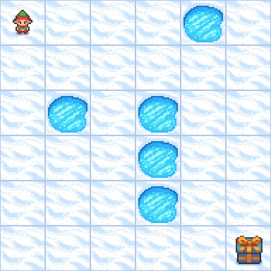
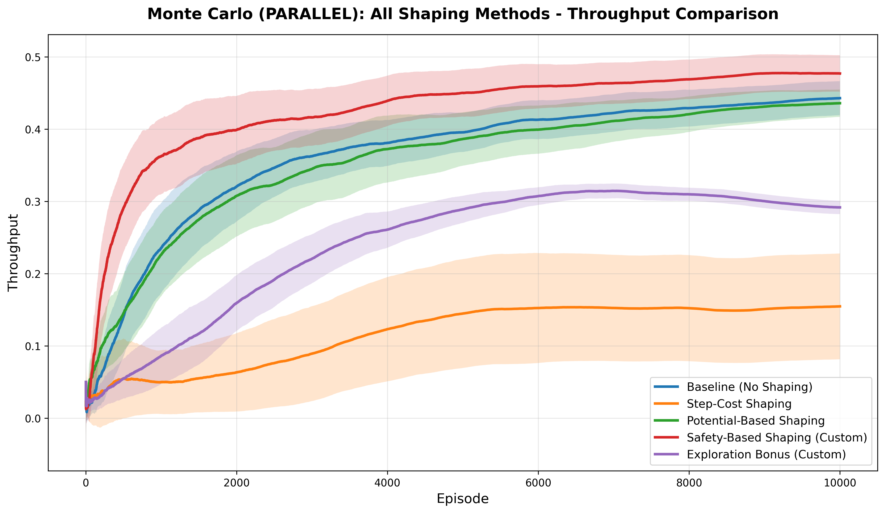
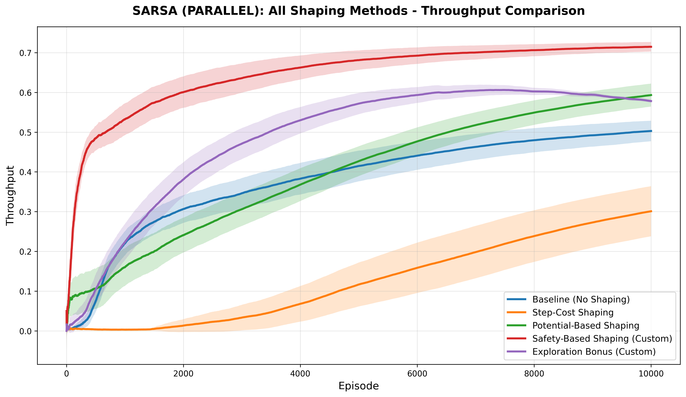
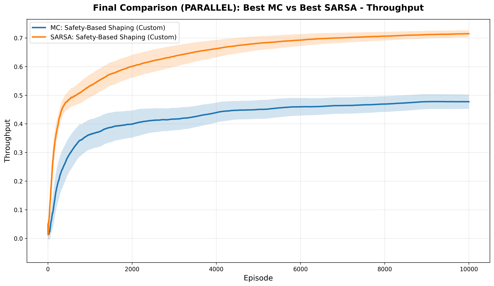
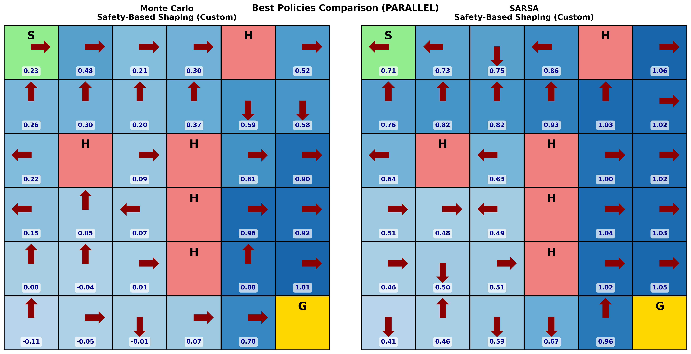
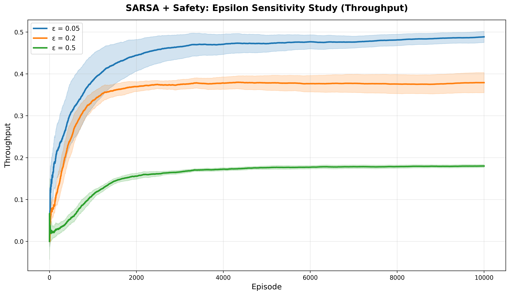
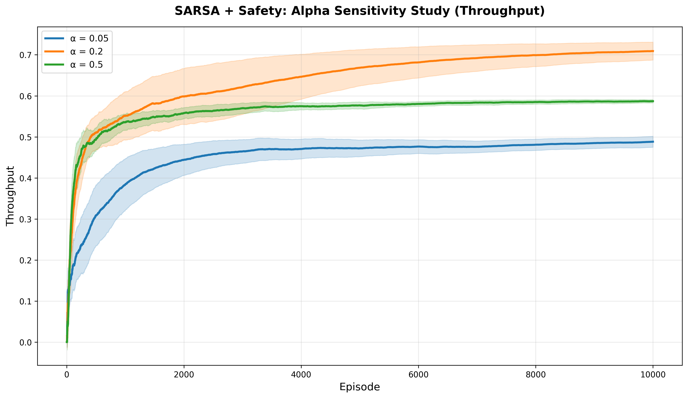
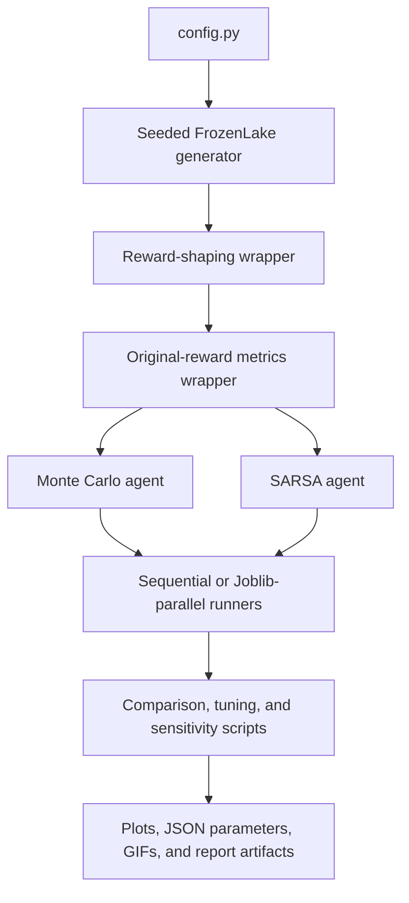

# Reward Shaping Analysis in Reinforcement Learning
### A Comparative Study of Monte Carlo and SARSA

> **Authors:** Ahmad Tawil · Yosef Jirees &nbsp;|&nbsp; January 2026

---

## Overview

This project investigates how **reward shaping** affects reinforcement-learning performance in a stochastic grid world. It implements two tabular control algorithms from scratch—**Every-Visit Monte Carlo Control** and **SARSA(0)**—and compares a baseline with four shaping strategies on a generated FrozenLake environment.

The included experiment artifacts report **71.46% throughput** for SARSA with safety-based shaping, a **42.1% relative improvement** over the recorded SARSA baseline. These results were generated with the repository's current custom transition implementation; see [Recorded Results](#recorded-results) and [Known Limitations](#known-limitations).

The repository also includes the generated plots, tuned hyperparameters, an animated policy demonstration, the LaTeX report source, and the compiled research paper: [Reward_Shaping_Analysis (7).pdf](<Reward_Shaping_Analysis%20(7).pdf>).

## Main Features

- Tabular Every-Visit Monte Carlo Control and SARSA(0) with epsilon-greedy action selection.
- Seeded FrozenLake map generation with reachability checks and a configurable grid, hole density, and stochastic transition weights.
- Baseline, fixed step-cost, goal-distance, safety-distance, and visit-count exploration reward variants.
- Sequential and Joblib-parallel experiment runners.
- Hyperparameter grid search plus epsilon, learning-rate, and shaping-strength sensitivity studies.
- Original-reward tracking alongside shaped training rewards.
- Throughput curves, confidence intervals, policy/value visualizations, screenshots, and animated GIF output.

## Technology Stack

| Technology | Purpose |
| --- | --- |
| Python 3.11+ | Algorithms, experiments, tests, and visualization scripts |
| Gymnasium / FrozenLake | Base reinforcement-learning environment |
| NumPy and pandas | Numerical computation and result processing |
| Matplotlib and Seaborn | Statistical plots and policy visualization |
| Joblib and tqdm | Parallel runs and progress reporting |
| Pygame and Pillow | Environment rendering and GIF/image generation |
| LaTeX | Research-report source |

---

## Live Demo — SARSA Safety-Based Agent

<p align="center">
  
</p>
<p align="center"><em>SARSA with safety-based shaping under the project's configured stochastic transition model</em></p>

---

## Environment

<p align="center">
  
</p>

| Parameter | Value |
|-----------|-------|
| Grid Size | 6 × 6 (36 states) |
| Hole Density | 15% (5 holes) |
| Configured transition weights | 0.70 / 0.15 / 0.15 |
| Discount Factor | γ = 1.0 |
| Goal Reward | +1 (sparse) |

The agent must navigate from **S** (top-left) to **G** (bottom-right) while avoiding holes. The custom environment rewrites Gymnasium's three slippery transition probabilities. In the current implementation, the `0.70` weight is applied to the first perpendicular transition rather than the intended action; this is retained to preserve the recorded experiments and documented under [Known Limitations](#known-limitations).

---

## Reward Shaping Methods

The goal-distance and safety methods use the potential-difference form `F(s,a,s') = β(γΦ(s') − Φ(s))`. The fixed step cost is a direct penalty, while the exploration bonus depends on changing visit counts; therefore, the standard stationary potential-based policy-invariance guarantee does not apply uniformly to every method.

| # | Method | Potential Φ(s) | Core Idea |
|---|--------|---------------|-----------|
| 1 | **Baseline** | — | No shaping; sparse +1 at goal only |
| 2 | **Step-Cost** | — | Fixed penalty `c` per step encourages shorter paths |
| 3 | **Potential-Based Distance** | `−d(s)` | Manhattan distance gradient pulls agent toward goal |
| 4 | **Safety-Based (Custom #1)** | `min_h d(s,h)` | Distance from nearest hole — avoids hazards |
| 5 | **Exploration Bonus (Custom #2)** | `−√(count(s)+1)` | Novelty bonus decaying with revisits |

---

## Recorded Results

> The values below are transcribed from the included plots and report. They were not recomputed during repository preparation, and they reflect the current custom transition-order behavior described in [Known Limitations](#known-limitations).

### Monte Carlo — All Shaping Methods

<p align="center">
  
</p>

| Method | Throughput | Avg Return |
|--------|:----------:|:----------:|
| **Safety-Based (Custom)** | **47.71% ± 5.76%** | **0.400 ± 0.490** |
| Baseline | 44.30% ± 5.36% | 0.600 ± 0.477 |
| Potential-Based | 43.60% ± 4.32% | 0.400 ± 0.490 |
| Exploration Bonus | 29.18% ± 2.11% | 0.450 ± 0.497 |
| Step-Cost | 15.47% ± 16.67% | 0.200 ± 0.400 |

---

### SARSA — All Shaping Methods

<p align="center">
  
</p>

| Method | Throughput | Avg Return |
|--------|:----------:|:----------:|
| **Safety-Based (Custom)** | **71.46% ± 2.74%** | **0.650 ± 0.477** |
| Potential-Based | 59.32% ± 6.68% | 0.850 ± 0.357 |
| Exploration Bonus | 57.81% ± 0.89% | 0.400 ± 0.490 |
| Baseline | 50.29% ± 5.90% | 0.800 ± 0.400 |
| Step-Cost | 30.10% ± 14.13% | 0.650 ± 0.477 |

---

### Best MC vs Best SARSA — Final Comparison

<p align="center">
  
</p>

**SARSA + Safety-Based Shaping** outperforms **MC + Safety-Based** by **+49.8%** (71.46% vs 47.71%).  
SARSA's step-level updates let it incorporate shaping signals immediately; MC must wait until episode completion.

---

### Learned Policies

<p align="center">
  
</p>

| | MC + Safety | SARSA + Safety |
|-|:-----------:|:--------------:|
| Q-value range | −0.11 to 1.01 (some negative) | 0.41 to 1.06 (all positive) |
| Confidence | Uncertain near holes | Clear gradients toward goal |

---

### Policy Evolution During Training

<p align="center">
  
</p>

<p align="center"><em>The current rendering script captures policy snapshots at episodes 1, 500, and 10,000.</em></p>

---

## Hyperparameter Sensitivity

### ε Sensitivity — SARSA + Safety

<p align="center">
  
</p>

| ε | Throughput |
|:-:|:----------:|
| **0.05** | **48.79% ± 2.16%** |
| 0.2 | 37.89% ± 3.87% |
| 0.5 | 17.98% ± 0.57% |

The environment's stochastic transitions provide additional state exploration, so the recorded study found that a low explicit exploration rate performed best for this configuration.

### α Sensitivity — SARSA + Safety

<p align="center">
  
</p>

| α | Throughput |
|:-:|:----------:|
| **0.2** | **70.89% ± 3.54%** |
| 0.5 | 58.68% ± 0.65% |
| 0.05 | 48.79% ± 2.16% |

α = 0.2 balances fast adaptation with stability — critical in a high-variance stochastic environment.

---

## Key Findings

1. **SARSA + Safety-Based Shaping recorded the highest throughput** — 71.46% across the 10 evaluated configurations
2. **Shaping effectiveness is algorithm-dependent** — Safety shaping gives SARSA +42.1% but only MC +7.7%
3. **SARSA baseline beats all MC variants** — 50.29% vs 47.71% (best MC), showing TD learning's stochastic advantage
4. **Step-cost backfires** — Penalty accumulation from slippage causes hole-seeking; high variance (±14–17%) reflects bimodal behavior
5. **Potential-based shaping helps SARSA** — +18% over SARSA baseline (59.32% vs 50.29%), though safety guidance is more effective

---

## Algorithms

### Every-Visit Monte Carlo Control
Updates Q-values after **complete episodes** — must wait for full return G before learning:
```
Q(s,a) ← Q(s,a) + α[G − Q(s,a)]     where G = Σ γᵗ Rₜ
```

### SARSA(0)
Updates Q-values after **each step** — immediately bootstraps from next state:
```
Q(s,a) ← Q(s,a) + α[r + γQ(s',a') − Q(s,a)]
```

Both use **ε-greedy action selection** with per-method optimized hyperparameters (selected via grid search over ε ∈ {0.05, 0.1, 0.2}, α ∈ {0.05, 0.1, 0.2}).

---

## System Architecture



`config.py` is the single configuration source. The environment and wrapper layers produce the training signal and preserve the original rewards; experiment runners then execute independent agent runs and feed the resulting arrays to plotting and reporting utilities.

---

## Quick Start

**Requirements:** Python 3.11+ and `pip`. The pinned `numpy==2.3.5` release does not install on Python 3.10 or earlier.

```bash
# Clone the repository
git clone https://github.com/yosef2000138/reward-shaping-analysis-main.git
cd reward-shaping-analysis-main

# Create and activate virtual environment
python3.11 -m venv .venv
source .venv/bin/activate        # macOS / Linux
# .venv\Scripts\activate        # Windows PowerShell

# Install dependencies
python -m pip install --upgrade pip
python -m pip install -r requirements.txt
```

### Run Experiments

```bash
# Main comparison — all methods and both algorithms, using all CPU cores
python compare_methods_parallel.py

# Lower-memory sequential alternative
python compare_methods.py

# Epsilon and learning-rate sensitivity analysis
python hyperparameters_sweep.py

# Shaping-strength comparison
python beta_comparison.py

# Interactive hyperparameter search
python find_best_hyperparameters.py

# Policy snapshots and animated GIF
python test_agent_rendering.py
```

Full experiments are CPU-intensive, run thousands of episodes across multiple independent runs, and call `plt.show()`. Use a graphical Matplotlib backend, or adjust the scripts for a headless environment. To shorten runs, set `TEST_MODE = True` in `config.py` before execution.

---

## Project Structure

```text
reward-shaping-analysis-main/
├── algorithms/
│   ├── monte_carlo.py              # Every-Visit MC Control
│   └── sarsa.py                    # SARSA(0)
├── env/
│   ├── frozenlake_env.py           # Environment wrapper
│   ├── reward_shaping.py           # All 5 shaping implementations
│   └── metrics_wrapper.py          # Metrics tracking
├── experiments/
│   ├── run_monte_carlo_parallel.py
│   ├── run_sarsa_parallel.py
│   └── ...
├── utils/
│   ├── metrics.py                  # Throughput & return computation
│   ├── plotting.py                 # Learning curve visualization
│   └── visualization.py            # Policy grid visualization
├── results/
│   ├── agent_demos/
│   │   ├── sarsa_safety_best.gif   # Animated agent demo
│   │   └── policy_evolution.png    # Training snapshots
│   └── *.png                       # All experiment plots
├── tests/                           # Executable validation scripts
├── config.py                       # All hyperparameters (single source of truth)
├── compare_methods_parallel.py     # Main experiment script
├── hyperparameters_sweep.py        # ε/α sensitivity study
├── beta_comparison.py              # β sensitivity study
├── find_best_hyperparameters.py    # Grid search for best params
├── report.tex                      # LaTeX report source
└── Reward_Shaping_Analysis (7).pdf # Compiled research report
```

---

## Configuration

All parameters are centralized in `config.py`:

```python
GRID_ROWS, GRID_COLS = 6, 6   # Environment dimensions
HOLE_DENSITY        = 0.15    # 15% holes
IS_SLIPPERY         = True    # Stochastic dynamics
SUCCESS_RATE        = 0.7     # Primary configured transition weight; see limitations
FINAL_EPISODES      = 10000   # Episodes per run
FINAL_RUNS          = 20      # Independent runs (for 95% CI)
RANDOM_SEED         = 242     # Reproducibility seed
```

For quick testing: set `TEST_MODE = True` (1000 episodes, 5 runs).

---

## Environment Variables, APIs, and Data

The project does not read environment variables or `.env` files. Experiment parameters are edited directly in `config.py`; no secrets are required.

There is no HTTP API, network protocol, database, or external dataset. Communication is entirely through in-process Python calls, NumPy arrays, generated environment transitions, and files written to `results/`.

---

## Testing and Verification

The repository provides two executable validation suites:

```bash
python tests/test_metrics_calculation.py
python tests/test_experiment_setup.py
```

Current observed status with Python 3.11 and the pinned requirements:

| Check | Result |
| --- | --- |
| Dependency installation and `pip check` | Passed |
| Python source compilation with `compileall` | Passed |
| 10-episode, two-run Monte Carlo baseline smoke test | Passed |
| 10-episode, two-run SARSA baseline smoke test | Passed |
| Metrics validation script | Starts; throughput check passes, then fails on missing `config.EPSILON` |
| Experiment validation script | Map and probability-set checks pass, then reproducibility fails on missing `config.EPSILON` |

The test files also reference removed `config.ALPHA` and `config.BETA_SAFETY` names. They need to be updated to use `get_optimized_hyperparams()` and `get_shaping_params()` before the complete suites can pass. `pytest` is not currently included in `requirements.txt`; the supported commands above run the suites directly.

---

## Known Limitations

- **Transition ordering:** `CustomSlipperinessFrozenLake` assigns the `0.70` probability to Gymnasium's first slippery outcome, which is the left-perpendicular action, while the intended action receives `0.15`. The recorded plots and report were produced with this behavior, so it is documented rather than silently changed.
- **Stale tests:** several tests use configuration constants that no longer exist, preventing both full validation scripts from completing.
- **Square-grid assumption:** distance and safety wrappers derive both dimensions from `len(desc)` and iterate `grid_size²`; rectangular configurations are not fully supported.
- **Reward-shaping guarantees:** step cost is not potential-based, and the visit-count exploration bonus is non-stationary. The standard policy-invariance guarantee does not cover every configured strategy.
- **Report rebuild:** the compiled PDF is included, but `report.tex` references figure names/locations that do not match the current `results/` layout and does not rebuild without path corrections.
- **Interactive and expensive runs:** full comparison scripts use all CPU cores and open Matplotlib windows. Runtime depends heavily on hardware and configuration.
- **Recorded results:** the complete 20-run, 10,000-episode study was not rerun as part of repository preparation; the tables summarize the checked-in research artifacts.
- **Licensing:** no license file is included. The project retains its original coauthor attribution and should not be presented as open source without both authors' authorization.

---

## References

1. Ng, A. Y., Harada, D., & Russell, S. (1999). *Policy invariance under reward transformations: Theory and application to reward shaping*. ICML, Vol. 99, pp. 278–287.
2. Sutton, R. S., & Barto, A. G. (2018). *Reinforcement learning: An introduction* (2nd ed.). MIT Press.
